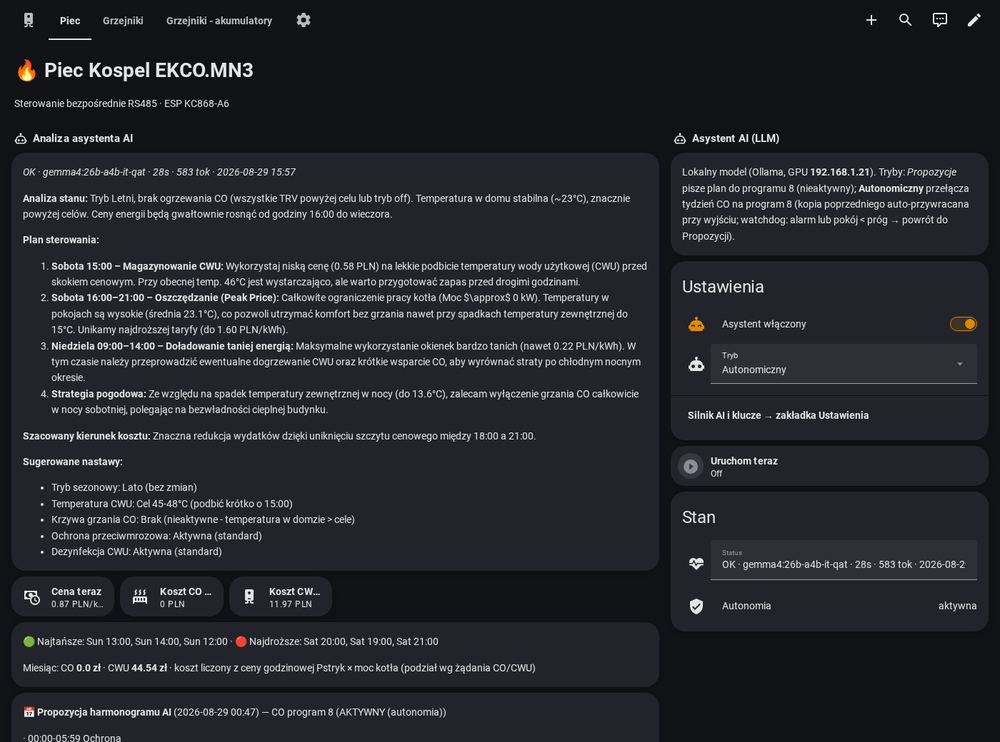
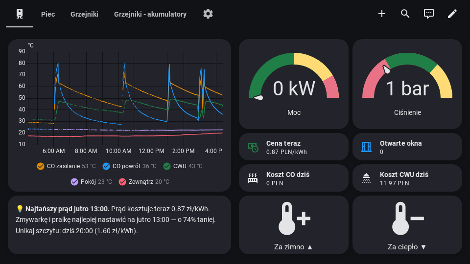
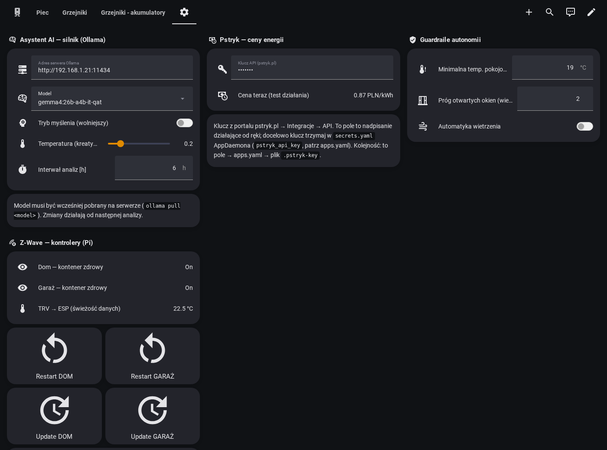

# esphome-kospel

🇵🇱 [Wersja polska](README.pl.md)

**Full local control of a Kospel EKCO.MN3 electric boiler (+ C.MG3 mixing module) over RS485 —
with an optional local-LLM "AI caretaker" that steers heating around dynamic electricity prices.**

Born when the original Kospel **C.MI** internet module started dying. Instead of replacing it,
this project puts an ESP32 (Kincony **KC868-A6**) on the RS485 bus as the Modbus master and
re-implements the C.MI's entire feature set in [ESPHome](https://esphome.io) — then goes further:
price-aware schedules, per-room window failsafe, cost accounting good enough to bill tenants,
and a supervised autonomous mode with hard guardrails.

> ⚠️ **Disclaimer**: this controls real heating hardware over an undocumented (reverse-engineered)
> protocol. Registers were mapped from the C.MI's local web app and live bus sniffing on
> EKCO.MN3 + C.MG3. Use at your own risk. Never run the ESP master and the C.MI on the bus
> at the same time (the firmware includes relay-based bus handover if you wire the C.MI through
> relays 5/6).

## What you get

- **1:1 C.MI feature port** — temperatures, power, pressure/flow, operating modes, weekly
  programs + daily-program editor (all 4 timetables: CO / CWU / circulation / C.MG3), heating
  curves, disinfection (anti-legionella), pump config, special modes (party/vacation/turbo),
  RTC sync from NTP, error decoding — ~150 entities in Home Assistant.
- **Write pending/confirm framework** — a changed setting *holds* in the UI until the heater
  confirms it (no snap-back); failures surface as a red banner + notification.
- **AI caretaker (optional)** — an AppDaemon app driving a local LLM (Ollama): analyses state,
  weather forecast, 6 h trends and hourly prices ([pstryk.pl](https://pstryk.pl)); writes proposed
  daily programs into the heater's unused **program 8** (shadow mode) or actively points the week
  at them (**Autonomiczny**) with watchdog + automatic rollback. Learns the household's hot-water
  rhythm from tank-temperature draw detection — no water meter needed.
- **Two planners, your choice (v2)** — `input_select.kospel_planer`: **LLM** (the language model
  designs the programs), **Silnik** (a deterministic engine: fitted thermal model of the house +
  tank model + hot-water usage clusters + prices, no GPU needed) or **Hybryda** (the engine plans,
  the LLM audits and may amend). The engine's plan is always published for comparison. Preference
  slider (Oszczędność / Balans / Komfort), presence-aware eco mode, "too cold / too warm" feedback
  buttons, daily savings vs flat tariff, weekly digest, pressure/tank-degradation diagnostics and a
  one-click backtest — see [docs/ENGINE.md](docs/ENGINE.md). Running in **Hybryda** on the author's
  heater since 2026-09-04.
- **Hard rules + self-healing guard (v2.1)** — whatever the planner (LLM, engine, hybrid amendment)
  produces passes `enforce_rules()` before it reaches the heater: DHW levels normalised (the CWU
  timetable knows only *no heating* and *comfort*), no-heating only in an adaptive night window
  (2 h after the last observed evening draw → 05:00), 1-hour comfort charges within a daily budget
  (3/4/6 h by preference), a charge in the last cheaper hour before the day's real price peak
  (a ≤5 h block around the maximum, not Pstryk's `is_expensive` flag), circulation capped per
  cluster / in the peak / per day, and a **tank floor** (<35 °C with draws ahead → economic upkeep,
  <30 °C → heat now regardless of price). A 20-second monitor re-applies the rules to the programme
  actually on the heater and rewrites only CWU when needed, whether the autonomy flag survived an HA
  restart or not. Corrections are visible in the schedule sensors (`zrodlo`, `korekty_regul`).
- **Price-driven power plan (opt-in)** — the heater has no native power schedule, so the AI
  pushes a rolling 24 h plan into the ESP (expensive hours 12 kW, normal 20, cheap 24) and the
  ESP executes it with local guards even with HA down: comfort floor, tank below 35 °C (heavy
  hot-water usage mid-peak → full power to recover, then re-cap) and anti-legionella always win;
  a stale plan (>26 h) safely reverts to full power; your own setting returns when autonomy exits.
- **Billing-grade energy/cost stack** — CO/CWU split power → kWh meters → PLN totals at exact
  hourly prices (Energy-Dashboard-ready, statistics kept forever).
- **Wall-panel dashboard** (1080p landscape tablet) + appliance advice card
  ("Prąd drogi — nastaw zmywarkę na 13:00, o 60% taniej").
- **Optional: Fibaro TRV integration** — per-room temperatures and open-window detection via a
  Z-Wave JS Pi; the ESP receives a UDP feed directly from the Pi, so the
  *windows-open → pause heating* failsafe works even with Home Assistant down.

## Screenshots

The AI caretaker's analysis and controls on the main dashboard:



Wall-panel view (1080p landscape tablet, no scrolling) with the appliance price advisor:



Settings view — Ollama engine, Pstryk API key, autonomy guardrails, Z-Wave controller health:



## Hardware

| Part | Notes |
|---|---|
| Kospel EKCO.MN3 | slave `0x65`; C.MG3 mixing module slave `0x69` |
| Kincony KC868-A6 (ESP32) | built-in RS485; 9600 8N1, Modbus RTU, func 0x03/0x10, little-endian on wire |
| RS485 A/B | to the heater's C.MI connector; optionally route the C.MI through relays 5/6 for bus handover |
| *(optional)* Raspberry Pi + Z-Wave stick | zwavejs2mqtt/Z-Wave JS UI for Fibaro FGT-001 TRVs |
| *(optional)* any box with a GPU | Ollama for the AI caretaker (a ~30B-class model works well) |

## Install

**→ New here? Follow the detailed step-by-step guide: [docs/INSTALL.md](docs/INSTALL.md)**
(wiring, first USB flash, HA packages, dashboards import, Ollama + AppDaemon setup,
optional Z-Wave, verification checklist, troubleshooting).

The short version:

### 1. Firmware (required)

```bash
cd esphome
cp secrets.yaml.example secrets.yaml     # fill in; never commit
# Review the EDIT ME markers in gen_master.py (static IP, UDP feed address)
python3 gen_master.py                    # generates kc868-a6-heater-master.yaml
esphome run kc868-a6-heater-master.yaml
```

Add the device to Home Assistant (ESPHome integration, encrypted API). **Physically disconnect
the C.MI** (or wire it through relays 5/6 and use the "Bus owner" switch).

### 2. Home Assistant packages (required for costs/AI)

Enable packages in `configuration.yaml`, then copy from `homeassistant/packages/`:

- `kospel_helpers.yaml` — input helpers the AI expects (modes, thresholds, Ollama address)
- `kospel_energia.yaml` — CO/CWU power split, kWh meters, PLN cost integrals + daily/monthly
  meters. Point the Energy Dashboard at `sensor.kospel_energia_co/cwu` with your hourly price
  entity. Totals live in long-term statistics → season billing = end minus start.

`homeassistant/automations/` (paste each into a new automation in YAML mode) — power/price and
critical-alarm pushes, antifreeze override, heating-curve sync boiler ↔ C.MG3, airing resume, TRV
battery/stale-alarm/setpoint schedule. `homeassistant/scripts/` holds the *za zimno / za ciepło /
reset* curve buttons the dashboards call. Replace `notify.mobile_app_luke_iphone` with your phone.

`homeassistant/dashboards/wall_panel.json` is a ready wall-panel view (paste into a dashboard
via raw editor; fits 1080p landscape tablets without scrolling). It references two aggregate
sensors from the optional TRV setup (`sensor.dom_otwarte_okna`, `sensor.dom_temperatura_min`) —
remove those two tiles or point them at your own sensors if you skip Z-Wave.

### 3. Enable the AI caretaker (optional)

1. Run [Ollama](https://ollama.com) somewhere on your LAN and pull a model
   (e.g. `ollama pull gemma4:26b-a4b-it-qat`). A load balancer in front of several Ollama machines
   (e.g. HAProxy routing by model name) works transparently — the app only needs the base URL. It
   sends `think: false` and never overrides `num_ctx`, so server-side tuning stays in effect.
2. Install the **AppDaemon** add-on. Copy `appdaemon/kospel_llm.py` and `apps.yaml.example`
   (as `apps.yaml`) into the AppDaemon add-on's `apps/` folder (`/addon_configs/a0d7b954_appdaemon/apps/`,
   or `/app_configs/...` as seen from Terminal & SSH 10.5.0+).
3. Configure the app the AppDaemon-canonical way — `apps.yaml` args with `!secret`
   (see `apps.yaml.example` + `secrets.yaml.example`): `ollama_host` and `pstryk_api_key`.
   The **Ustawienia** dashboard view offers runtime overrides on top (a password-type
   `input_text.kospel_pstryk_api_key` helper and the Ollama host field) — handy, but note an
   input_text state is readable by any logged-in HA user; secrets.yaml is the more private home
   for the key. Resolution order: UI helper > apps.yaml > legacy `.pstryk-key` file.
4. Set `input_text.kospel_llm_host` to your Ollama URL, pick the model, and switch
   `input_select.kospel_llm_tryb` through the maturity ladder:
   - **Doradca** — analysis text only, writes nothing;
   - **Propozycje (shadow)** — additionally writes proposed daily programs into **program 8**
     (inactive unless you point a weekday at it) — run this for a few days and read its plans;
   - **Autonomiczny** — backs up your weekly assignments, points CO/CWU/circulation at
     program 8, and keeps refreshing it. Exit the mode (or any watchdog trip) restores your
     backup automatically.

   Guardrails in autonomous mode: boiler alarm (debounced), room-temperature floor
   (`input_number.kospel_ai_min_pokoj`), ESP-offline grace, daily write budget, and the AI can
   only ever *downgrade* itself — it never enables autonomy.

### 4. Fibaro TRVs via Z-Wave (optional)

Skip this entirely if you don't have Z-Wave radiator heads — everything above works without it.

1. On the Pi running Z-Wave JS: install `zwave-agent/zwave_agent.py` (see
   `zwave-agent.service.example`; edit the `TRV` node-id→room map).
   The agent serves `/trv.json` + `/health`, self-heals the zwave-js container
   (restart/rollback-safe update), and **pushes** `{okna, min_temp}` to the ESP by UDP every
   30 s — deliberately push-over-UDP: an HTTP pull from the ESP proved to disrupt its HA API
   connection (see Lessons).
2. Copy `homeassistant/packages/kospel_zwave.yaml` (edit the Pi IPs) for health sensors +
   restart/update REST commands, and optionally run `zwave-agent/selfheal_automations.py`
   to create the down→restart / stale→update / weekly-update automations.

## Modbus map (highlights)

All values little-endian **on the wire** (byte-swapped vs Modbus convention). Slaves: heater
`0x65`, C.MG3 `0x69` (rejects coalesced wide reads — use single-register commands).

| Area | Registers |
|---|---|
| Temperatures (CO in/out, CWU, room, outside…) | `0x0B3B…0x0B50` region |
| Status / mode / error words | `0x0B51`, `0x0B55` (bit3 = Lato, bit5 = Zima), `0x0B52` |
| Setpoints (DHW eco/comfort, room, CO max/manual, curves) | `0x0B62…0x0B8D` |
| Daily programs (5 slots × start/stop/level) | CO base `0x0C1C`, CWU `0x0C9E`, circulation `0x0D20`, C.MG3 `0x0B90`; program *N* = base + 15·(N−1) |
| Weekly assignments (Mon..Sun) | CO `0x0C94-0x0C9A`, CWU `0x0D16-0x0D1C`, circ `0x0D98-0x0D9E`, C.MG3 `0x0C08-0x0C0E` |
| Clock | **broadcast**, address `0x00`, function `0x01`, every 60 s: `00 01 08 YY MM DD WD hh mm ss 00` + CRC (YY = year−2000, WD 0 = Monday). Sets the heater's and the C.MG3's clocks. Read-back: `0x0AF6…0x0AFC` (s, min, h, dow, day, month, year). **A direct write to `0x0AF6` is rejected with exception 2** — the C.MI never does it |
| Heat-request relay | write 2 words to `0x0BAE` every ~10 s: idle `[0, 1]`; C.MG3 asking for heat `[T×10, 3]`, T = module setpoint + 5 K |
| Heater state → C.MG3 | **broadcast**, address `0x00`, function `0x02`, 18 words every ~10 s — the module's only source of the boiler's room/outside temperature, room levels and mode |
| Identification | function `0x11` (Report Slave ID): heater answers `13 FF 00 01 32 01 14 01` → `01 32` = MSK 1.50, `01 14` = PW 1.20 (this is how the C.MI shows the program versions) |

Some config registers only latch when the config word (`0x0B55`/`0x0B54`) is re-written in the
same burst — the generator handles these "gated" writes.

The two broadcasts are part of the bus master's job (the C.MI sends them, so the ESP must too).
ESPHome's modbus hub refuses frames to address 0, so the firmware writes them straight to the UART
(CRC appended) in an idle gap between polls, with the hub's `turnaround_time` cut to 50 ms.
Tested against MSK 1.50 / PW 1.20 at 9600 8N1.

## Config flags & season

The heater's season and subsystem-enable flags live in one word (`0x0B55`). There's a
non-obvious ordering rule (enable the DHW tank *before* selecting summer) and a safe recovery
procedure — see **[docs/CONFIG-FLAGS.md](docs/CONFIG-FLAGS.md)**.

## Lessons learned (the expensive ones)

- **The C.MI never writes the heater's clock register — it broadcasts the time.** Our first
  release wrote the RTC block at `0x0AF6` hourly; the boiler rejects that with exception 2, and the
  clock only looked right because the boiler's own clock was already correct. Sniff the original master for a while before
  you trust a register map: it also broadcasts the heater state to the C.MG3 every 10 s and relays
  the module's heat request — duties you inherit when you replace it.
- **ESPHome's modbus hub won't send broadcasts** ("a broadcast (address 0) is never answered") and its
  default 600 ms `turnaround_time` kept it busy ~85 % of the time. Write broadcast frames to the UART
  yourself when `tx_blocked()` is false, and drop the turnaround to 50 ms.
- **ESPHome `http_request` polling can reset your API connection.** Periodic 0.5 s
  `unavailable` blips in HA quantized *exactly* to the poll period (proved by switching the
  interval to a prime 127 s). Fix: invert to UDP push. If you see dotted graphs, suspect any
  periodic network activity in your firmware first.
- `post_connect_roaming` and `power_save_mode: light` (ESP32 default) both cause drops on
  weak RSSI for stationary devices — disable both.
- ESPHome's API allows **5 concurrent connections** — stale `esphome logs` sessions can starve
  Home Assistant itself.
- A boiler alarm sensor computed from a not-yet-read register briefly reads garbage after every
  reboot — guard NaN, and debounce watchdogs that act on it.
- **Season needs the DHW tank enabled first** — writing summer while the tank is off silently
  reverts (see docs/CONFIG-FLAGS.md). The heater owns `0x0B55`; enable preconditions, then season.
- **In the CWU timetable level 1 means "do not heat the tank at all"**, not a protective
  temperature. A rule that put level 1 into every hour Pstryk flagged as expensive (13 hours that
  day) starved the tank to 20 °C during the evening draws. Never gate behaviour on a provider's
  relative flag — derive the real price peak yourself and always keep a tank-temperature floor.
- **Economic upkeep all night costs a 20 kW burst every ~4 h; a 2-hour comfort slot adds another.**
  A tank charges in ~10 minutes, so comfort slots are 1 hour and the night is a no-heating window.
  But make that window adaptive: a fixed 22:00 start met a 22:15 bath and left 24 °C water for
  2.5 hours.
- **A Home Assistant helper created with an `initial:` value resets to it on every restart.** Our AI-mode
  select was created that way, so each HA restart silently flipped it from Autonomiczny back to shadow and
  the app dutifully disengaged "by user" and "restored" a backup that was itself all 8s. Never set
  `initial` on a helper that holds state you care about, and keep the pre-AI backup when the maps already
  point at the AI programme.
- **Guard on what the heater actually runs, not on your own flags.** A network outage (router
  firmware upgrade) dropped the autonomy flag while the weekly maps still pointed at the AI programme;
  a guard keyed on the flag stayed inert. Key it on the weekly maps.
- **Find out which device really runs the schedule.** With the boiler set up as a heat source, the heating
  circuit followed the C.MG3's own programs, so for weeks the AI's CO plan changed nothing. And the C.MG3
  silently ignores a timetable written as one 15-register block, with no error, while accepting the same
  data one register at a time. Read it back from the device before you trust a write.
- **Split energy by the flag you can trust.** The CO meter counted power only while the boiler's own
  CO-demand flag was on, but with an external room regulator or a C.MG3 circuit controller that flag never
  asserts, so heating energy read zero. The DHW-demand flag is reliable, so CO is now defined as everything
  the boiler burns that is not charging the tank, and every kilowatt-hour lands in exactly one bucket.
- **Suspend on a lost link, don't disengage.** When the ESP went offline the watchdog disengaged autonomy and
  tried to restore the weekly programs, over the same link that was down, so the restore was lost and the
  heater kept running the AI program with autonomy switched off. An outage now suspends and resumes, and a
  restore requested while offline is queued until the ESP returns.
- **The LLM's audit is a second opinion, not the last word.** In hybrid mode it flagged real issues
  but also contradicted itself ("too many comfort blocks", then added one). The deterministic rules
  are the final gate for every author.

## Changelog

**v2.5 (2026-11-18)**
- **Clock fixed:** the time is now sent as the C.MI does it — a once-a-minute broadcast (function `0x01`)
  — instead of writing `0x0AF6`, which MSK 1.50 / PW 1.20 rejects with exception 2.
- **ESP takes over the C.MI's full bus role:** heat-request relay for the C.MG3 (`0x0BAE`), heater-state
  broadcast (function `0x02`) that keeps the module's mirror of the boiler current, raw-UART broadcast
  transport, hub turnaround 50 ms (on-demand read latency ~26 s → <1 s).
- Robust airing failsafe (persisted flag, leaves on a stale TRV feed / cold room / after 2 h), power-cap
  hysteresis, fresh read-modify-write for season changes.
- **AI:** the plan never depends on the LLM; the house is seen through the TRVs (deficit vs setpoints,
  24 h history); boiler room setpoints follow the TRVs (Komfort+ = highest TRV setpoint); cold-room
  guard (any TRV room at/below a threshold forces CO Komfort+); free-text dialogue with the assistant;
  optional closed-loop comfort trim on the C.MG3 weather curve; savings/backtest survive an HA restart.
- **Engine:** never loses a DHW charge to slot compression; trust-gated coasting; the hybrid audit overlays
  CO amendments instead of replacing the plan.
- **Home Assistant:** new automations (antifreeze, curve sync, airing resume, TRV schedule, TRV stale
  alarms), curve scripts, four new helpers; CO power debounced so DHW transitions don't count as CO.
- **Z-Wave:** the agent reads the right FGT-001 status bits and the live battery; the self-heal
  automations use the REST reply as already-parsed JSON (the `from_json` filter broke the weekly update).

**v2.4 (2026-09-25)** — AI steers the C.MG3 circuit controller; HTTPS + optional API key for the LLM
endpoint; season steering (v2.3).

## Roadmap

- ~~Deterministic planning engine + hybrid LLM verification, savings & diagnostics~~ — shipped in v2 (docs/ENGINE.md).
- **Custom Home Assistant integration** (`custom_components/`) with a config-flow settings page —
  so the project shows up as a real HA integration (Ollama host, Pstryk key, etc.) instead of
  AppDaemon + helpers.
- **Symbolic config-flag write layer** — the C.MI writes flags like `FLAG_DHW_ACTIVATION_NO_YES`
  as named transactions (server-side register mapping). The ESP already covers season + the main
  enable flags via per-bit RMW switches (see docs/CONFIG-FLAGS.md); porting the *remaining* gated
  config groups (buffer/OPERATING_MODE, DHW int/ext with supply temp) is the last parity gap.


## License

MIT — see [LICENSE](LICENSE).
